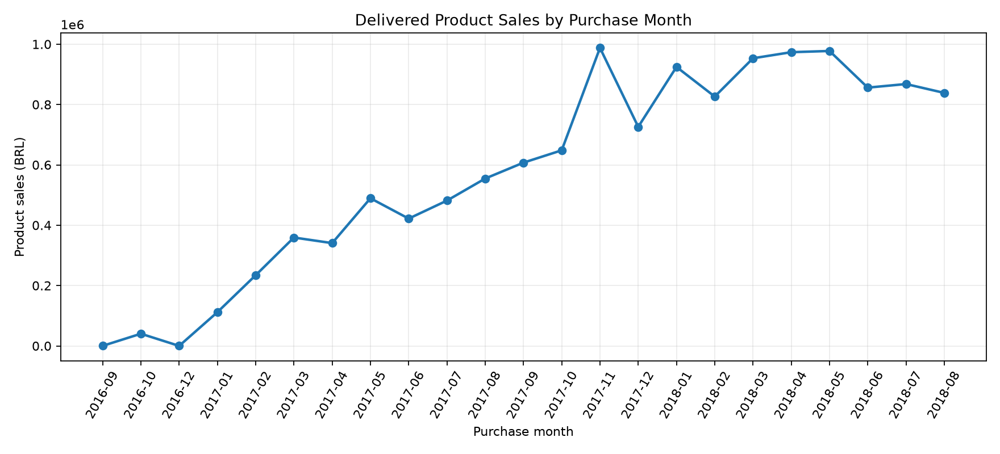
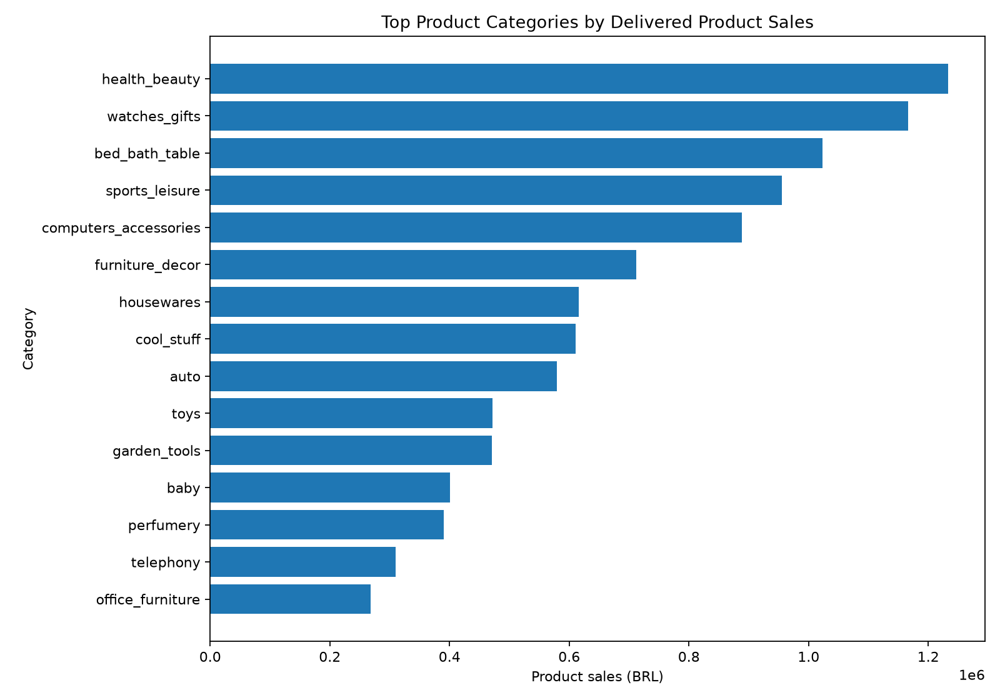

# P1 — E-commerce Sales Analytics (SQL + Python + Excel)

[← Back to portfolio](../README.md)

End-to-end analysis of ~100K real, anonymized orders from the Olist marketplace (Brazil, 2016–2018). Raw CSVs are loaded into a local **SQLite** database, analyzed with **advanced SQL (CTEs, window functions, `LAG()`)**, exported as reviewable tables and charts, and summarized in an **Excel workbook**.

**Source:** [Olist Brazilian E-Commerce Public Dataset (Kaggle)](https://www.kaggle.com/datasets/olistbr/brazilian-ecommerce) — CC BY-NC-SA 4.0.

## Headline numbers (delivered orders only)

| Metric                      | Value                             |
| --------------------------- | --------------------------------- |
| Delivered orders            | 96,478                            |
| Identified customers        | 93,358                            |
| Product sales               | R$ 13.22M                         |
| Freight                     | R$ 2.20M (16.6% of product sales) |
| Avg product value per order | R$ 137.04                         |

## Key findings

**1. Which categories drive sales?** Sales are concentrated: 5 of 74 categories (health & beauty, watches & gifts, bed/bath/table, sports & leisure, computers accessories) generate **39.8%** of product sales, the top 10 generate **62.4%**, and about 18 categories (~25%) reach **80%**. Health & beauty leads with R$ 1.23M (9.3%).

**2. Is growth broad-based or concentrated?** Both. Monthly sales rose from R$ 112K (Jan 2017) to R$ 925K (Jan 2018), with a Black Friday peak in Nov 2017 (7,289 orders). Data ends in Aug 2018, and Jan–Aug 2018 sales (R$ 7.22M) were **+141%** vs Jan–Aug 2017 (R$ 2.99M). By category, 45 of 72 categories grew in 2018 vs 2017 (2018 is a partial year, so growth is understated), but the five largest gainers (health & beauty, watches & gifts, housewares, auto, computers accessories) account for ~70% of the net R$ change. Some categories fell despite overall growth: computers (−60%), toys (−44%), cool stuff (−40%) among categories with ≥ R$ 50K in 2017.

**3. How are customers distributed?** Retention is the weak spot: **97.0%** of customers bought only once; repeat customers (3.0%) contribute just **5.5%** of sales. Median lifetime product value is R$ 89.73 (mean R$ 141.62), and the top 10% of customers generate **41%** of sales. Median recency is 267 days; only 10% purchased in the last 90 days of the dataset (reference date 2018-10-17).

**4. Freight and delivery timing?** Freight equals 16.6% of product sales. Average delivery time is ~12.6 days and 6.8% of orders arrive late overall, but lateness spikes in peak periods: Nov 2017 (12.4%), Feb 2018 (14.1%) and Mar 2018 (19.0%). Average delivery time improved to 7.7 days by Aug 2018.

**5. Payment reconciliation?** For delivered orders, payments (R$ 15,422,462) exceed items + freight (R$ 15,419,774) by only **R$ 2,688 (0.017%)**. Other statuses reconcile to within R$ 32. Data-quality flags to investigate: 775 orders have no items, and 8 delivered orders lack a delivery timestamp.

## Data quality

Duplicate IDs, orphan items/payments, negative prices and negative freight: **all pass (0)**.

## Charts





## Excel deliverable

`Sales_Analysis.xlsx` is generated by `build_excel.py` and contains 9 sheets: Executive Summary, Monthly Sales, Categories, YoY Growth, Pareto, Customer RFM, Delivery, Payment Reconciliation and Data Quality.

## Run

```bash
pip install -r requirements.txt
python download_data.py      # verifies the 8 Olist CSVs in data/raw/
python build_database.py
python analysis.py
python build_excel.py
pytest -q
```

## Metric definitions and limitations

- `product_sales_brl` = sum of item prices for delivered orders; freight is reported separately.
- No profit or margin is claimed (no product cost in the dataset).
- 2016 and 2018 are partial years; YoY comparisons need that context.
- RFM recency uses the dataset's latest purchase date, not today's date.
