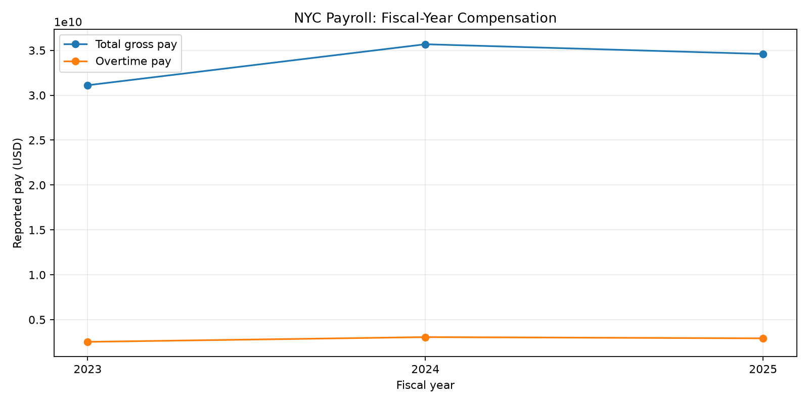
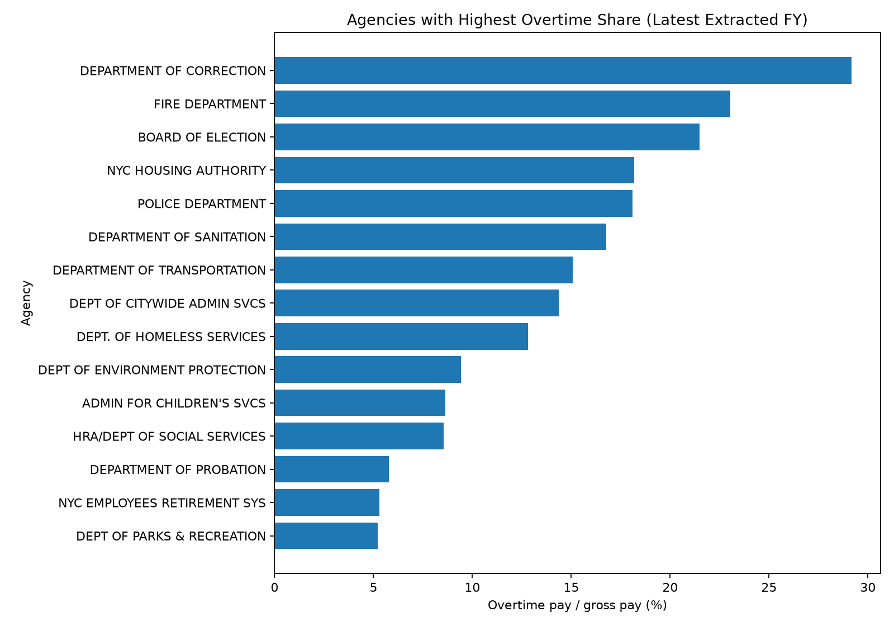

# P2 — NYC Workforce & Payroll Analytics (Python + Power BI + DAX)

[← Back to portfolio](../README.md)

Analysis of **1.67M real public payroll records** from NYC Open Data (fiscal years 2023–2025). Python prepares and profiles the data; Power BI + DAX visualizes compensation, overtime exposure and agency/job mix.

**Source:** [NYC Open Data — Citywide Payroll Data (Fiscal Year)](https://data.cityofnewyork.us/City-Government/Citywide-Payroll-Data-Fiscal-Year-/k397-673e). Employee names and identifiers are never requested.

## Headline numbers

| Fiscal year | Payroll records | Gross pay | Overtime pay | Overtime share | Avg annual-basis base salary |
| ----------- | --------------- | --------- | ------------ | -------------- | ---------------------------- |
| 2023        | 552,938         | $31.11B   | $2.53B       | 8.13%          | $82,925                      |
| 2024        | 562,898         | $35.68B   | $3.06B       | 8.57%          | $88,257                      |
| 2025        | 550,219         | $34.60B   | $2.92B       | 8.45%          | $91,497                      |

## Key findings

**1. How does gross pay change by fiscal year?** Gross pay rose **14.7%** in FY2024 and fell **3.0%** in FY2025, while records moved +1.8% and −2.3%. Part of the FY2024 jump is "other pay" ($2.41B → $3.38B); the data does not explain why. Average annual-basis base salary grew each year (+6.4%, +3.7%).

**2. Which agencies carry overtime?** Overtime is highly concentrated: in FY2025 five agencies hold **83%** of all overtime dollars — Police ($1.09B), Fire ($568M), Correction ($363M), NYC Housing Authority ($205M) and Sanitation ($204M). The highest overtime shares (agencies with ≥ 500 records) are **Correction 29.2%**, **Fire 23.0%**, Board of Elections 21.5%, NYCHA 18.2% and Police 18.1%. Education agencies show ~0% overtime, so they dilute the city-wide 8.5%.

**3. Which agencies and titles are largest?** The five largest agencies by gross pay (DOE pedagogical, Police, Fire, DOE paraprofessionals, Correction) make up **63%** of FY2025 gross pay. Police Officer is the biggest overtime title ($458M across 24,153 records), followed by Firefighter ($301M) and Correction Officer ($279M).

**4. Borough differences?** Manhattan has most records but a low overtime ratio (~4.5% of regular + overtime pay, reflecting office and education staff), while Queens, Brooklyn, the Bronx and Staten Island sit at ~17–20%. Work location is not residence.

**5. Data quality to resolve before publishing a dashboard?** 155,837 exact duplicate rows (kept and flagged — the extract has no unique ID, so some may be legitimate), 43,177 rows with negative pay/hour values (likely adjustments), and 78 missing agency start dates.

## Charts





## Run

```bash
pip install -r requirements.txt
python download_data.py
python analysis.py
pytest -q
```

Then import `data/processed/payroll_clean.csv` into Power BI Desktop and follow `powerbi/BUILD_GUIDE.md` (measures in `powerbi/measures.dax`).

## Limitations

- A row is a payroll record per fiscal year, not a unique person; **this is not an attrition analysis**.
- Base salary units differ by pay basis, so averages use annual-basis records only.
- Overtime share = overtime / reported gross pay (borough ratios above use overtime / (regular + overtime)).


