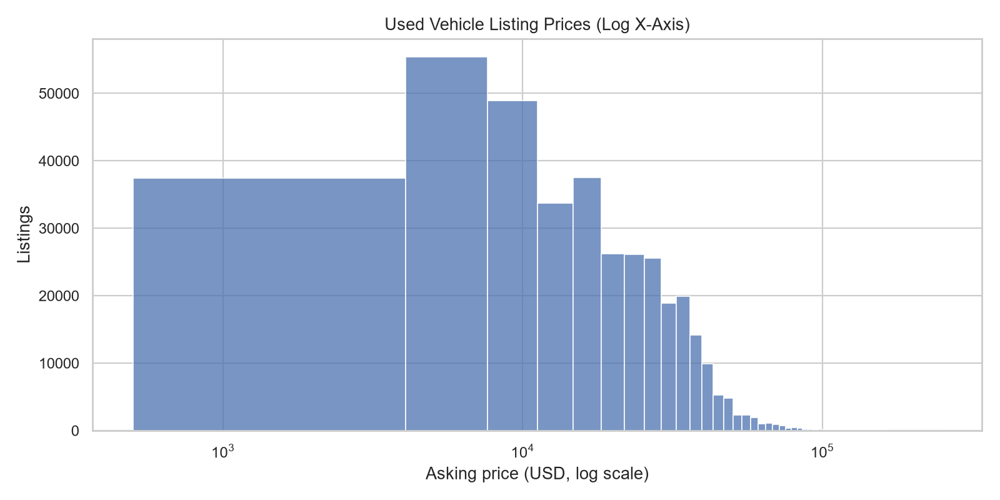
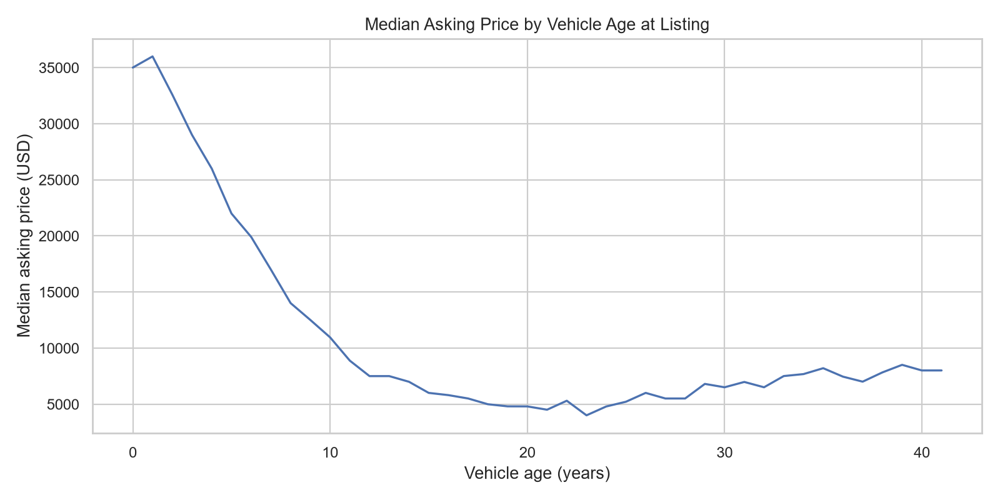
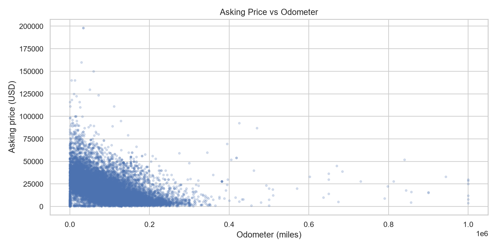
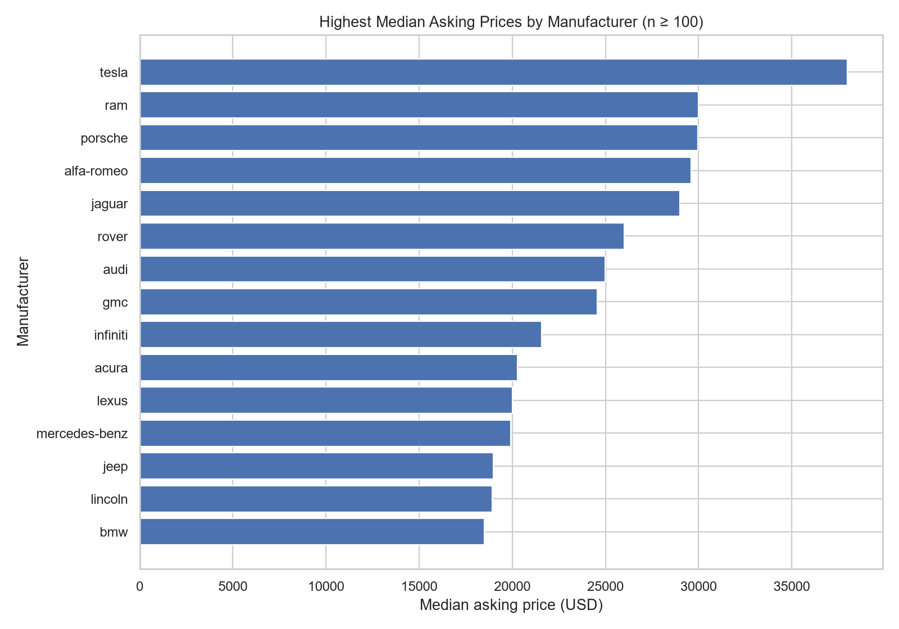

# P3 — Used Vehicle Listings EDA (Python)

[← Back to portfolio](../README.md)

Exploratory analysis of **426,880 real Craigslist used-vehicle listings** (US). The project documents every cleaning decision in a ledger, keeps statistical outliers instead of silently deleting them, and answers what drives asking prices: vehicle age, mileage and manufacturer.

**Source:** [Craigslist Cars & Trucks dataset by Austin Reese (Kaggle)](https://www.kaggle.com/datasets/austinreese/craigslist-carstrucks-data). Prices are *asking* prices, not verified sale prices.

## Cleaning summary

| Stage                                                     | Rows before | Rows after  | Removed               |
| --------------------------------------------------------- | ----------- | ----------- | --------------------- |
| Source loaded                                             | 426,880     | 426,880     | 0                     |
| Duplicate listing IDs (keep latest)                       | 426,880     | 426,880     | 0                     |
| Scope: price $500–$250,000, year 1980 to listing year + 1 | 426,880     | **375,515** | 51,365 (12.0%)        |
| Odometer outside 0–1,000,000 miles → set to missing       | 375,515     | 375,515     | 0 (312 values nulled) |

Engineered features: vehicle age at listing, miles per year, log price, and a per-manufacturer IQR outlier flag (6,710 listings flagged, 1.8%, all retained).

## Key findings

**1. How does asking price vary with age and mileage?** Strongly and negatively. Median asking price is **$15,900** (mean $19,277, so prices are right-skewed and medians are the fairer summary). Rank correlation with price is **−0.69 for vehicle age** and **−0.61 for odometer**.

| Vehicle age | Median price | Listings |
| ----------- | ------------ | -------- |
| 0–2 years   | $33,998      | 41,547   |
| 3–5         | $26,500      | 89,466   |
| 6–10        | $14,995      | 121,551  |
| 11–15       | $7,400       | 68,205   |
| 16–20       | $5,000       | 35,109   |
| 20+         | $5,500       | 19,637   |

| Odometer (miles) | Median price | Listings |
| ---------------- | ------------ | -------- |
| ≤ 25,000         | $30,590      | 59,767   |
| 25,000–75,000    | $23,900      | 100,599  |
| 75,000–125,000   | $12,900      | 98,695   |
| 125,000–175,000  | $7,995       | 72,560   |
| 175,000–250,000  | $5,900       | 35,631   |
| 250,000+         | $6,500       | 5,912    |

From the newest to the 16–20-year group, the median price falls by about **85%**. Both curves flatten at the old/high-mileage end and tick up slightly (20+ years, 250K+ miles); I did not test why, but a different mix of vehicles (older trucks, collectibles) is a plausible explanation.

**2. Which manufacturers have higher median asking prices?** (manufacturers with ≥ 1,000 listings)

| Highest median | Price   | Listings |     | Lowest median | Price   | Listings |
| -------------- | ------- | -------- | --- | ------------- | ------- | -------- |
| Ram            | $29,995 | 16,162   |     | Saturn        | $4,236  | 1,060    |
| Porsche        | $29,950 | 1,243    |     | Pontiac       | $4,499  | 1,905    |
| Jaguar         | $28,990 | 1,852    |     | Chrysler      | $7,999  | 5,467    |
| Rover          | $25,995 | 1,919    |     | Honda         | $9,250  | 19,404   |
| Audi           | $24,990 | 7,014    |     | Mazda         | $10,388 | 4,926    |
| GMC            | $24,553 | 15,045   |     |               |         |          |

These are raw medians, not brand effects: they mix vehicle age, mileage and body type (for example, trucks vs. older compact cars). Controlling for age and mileage would be the next step.

**3. Which columns are most incomplete, and how might that bias comparisons?** Condition (40.8% missing), cylinders (41.6%), drive (30.6%), paint color (30.5%) and vehicle type (21.8%) are the weakest; manufacturer is missing in 4.1%, odometer in 1.0% and year in 0.3%. Missing categories are labelled `Unknown` instead of dropped. Because sellers choose which fields to fill, missingness may correlate with price or seller type (this was not tested), so category-level comparisons should be read with that in mind.

**4. How sensitive is the profile to scope rules?** The price/year scope removes 12.0% of listings, so every conclusion above applies to the **$500–$250,000, 1980+** market only. A formal sensitivity run under alternative scopes has **not** been done yet; the ledger makes it easy to add.

## Charts









## Run

```bash
pip install -r requirements.txt
python download_data.py   # requires Kaggle credentials, or place vehicles.csv in data/raw/
python eda.py
python summarize_p3.py   # prints/saves the age, odometer and manufacturer tables quoted above
pytest -q
```

Outputs: `outputs/p3_summary.txt`, `outputs/cleaning_ledger.csv`, `outputs/raw_missingness.csv`, `outputs/quality_summary.csv`, `outputs/run_metadata.json`, charts in `charts/`.

## Limitations

- Asking prices from a particular scrape; not a current market index.
- Prices are right-skewed; medians and log scale complement means.
- Outlier flags are review aids, not proof of error.
- Review the Kaggle dataset license and source-site terms before redistribution.


