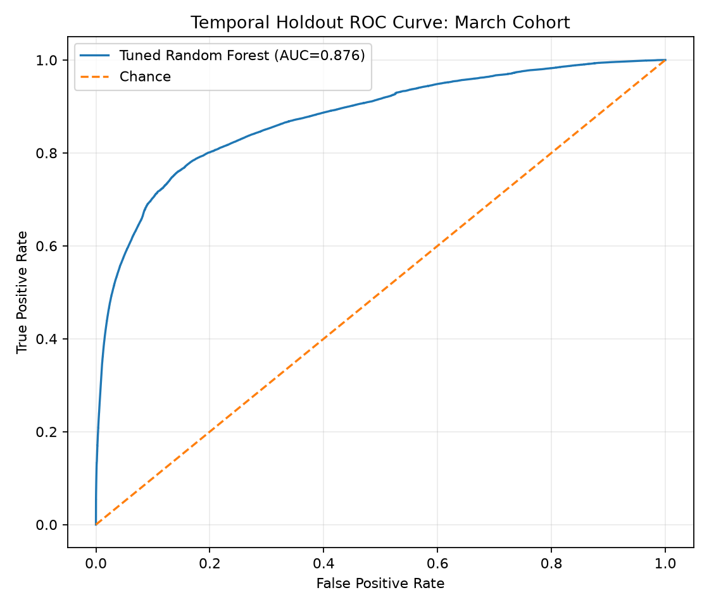
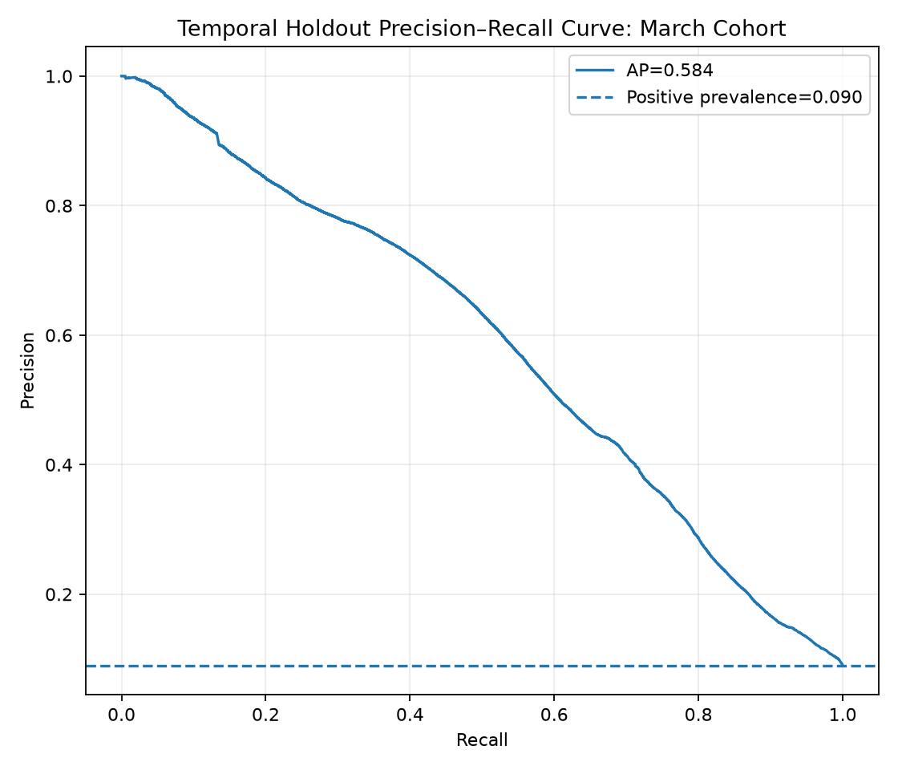
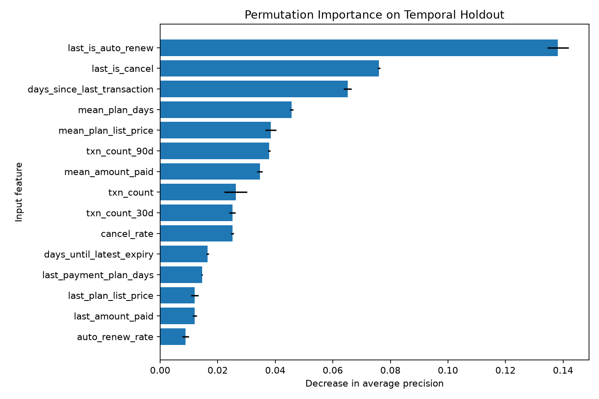

# P4 — Customer Churn Prediction (scikit-learn)

[← Back to portfolio](../README.md)

Predicts subscription churn for **~1M members** of KKBox, a music-streaming service, using the **official `is_churn` labels** from the WSDM / KKBox Churn Prediction Challenge. Features are built from transaction and membership history with explicit leakage controls, and the model is evaluated on a **later cohort** (temporal holdout) rather than a random split.

**Source:** [KKBox's Churn Prediction Challenge (Kaggle)](https://www.kaggle.com/competitions/kkbox-churn-prediction-challenge/data). Access requires a Kaggle account and acceptance of the competition rules.

## Setup of the experiment

|                                     | Training cohort                 | Temporal holdout                |
| ----------------------------------- | ------------------------------- | ------------------------------- |
| Labels                              | `train.csv` (February expiries) | `train_v2.csv` (March expiries) |
| Feature cutoff                      | transactions up to 2017-01-31   | transactions up to 2017-02-28   |
| Members                             | 992,931                         | 970,960                         |
| Churn rate                          | 6.39%                           | 8.99%                           |
| Members with no transaction history | 2,097                           | 2,527                           |

Only transactions dated on or before each cohort's cutoff are used. Target, member ID and date fields are excluded from the inputs. The model family is a Random Forest tuned with `GridSearchCV` (3-fold, average precision, on a 100K stratified sample), compared against a prior baseline and a balanced logistic regression.

## Results on the held-out March cohort

| Model                        | ROC-AUC   | Avg. precision | Precision @0.5 | Recall @0.5 | F1 @0.5   |
| ---------------------------- | --------- | -------------- | -------------- | ----------- | --------- |
| Prior baseline               | 0.500     | 0.090          | 0.000          | 0.000       | 0.000     |
| Balanced logistic regression | 0.846     | 0.539          | 0.422          | 0.679       | 0.520     |
| **Tuned random forest**      | **0.876** | **0.584**      | **0.439**      | **0.677**   | **0.533** |

Best parameters: 200 trees, `max_depth=18`, `min_samples_leaf=5`, `max_features="sqrt"`.

**What this means**

- The Random Forest ranks members well: ROC-AUC 0.876, and an average precision of 0.584 against a 9.0% churn base rate, roughly **6.5× better than chance**.
- At the stated 0.5 threshold it catches **68%** of the members who really churned (59,125 of 87,330), at the cost of **75,503 false alarms**; only 44% of flagged members actually churn. The threshold should be chosen from the retention team's cost of a wasted offer vs. a lost subscriber.

| Confusion matrix | Predicted stays | Predicted churns |
| ---------------- | --------------- | ---------------- |
| Actually stayed  | 808,127         | 75,503           |
| Actually churned | 28,205          | 59,125           |

**What drives churn** (permutation importance, drop in average precision)

| Rank | Feature                       | Importance |
| ---- | ----------------------------- | ---------- |
| 1    | `last_is_auto_renew`          | 0.138      |
| 2    | `last_is_cancel`              | 0.076      |
| 3    | `days_since_last_transaction` | 0.065      |
| 4    | `mean_plan_days`              | 0.046      |
| 5    | `mean_plan_list_price`        | 0.038      |
| 6    | `txn_count_90d`               | 0.038      |

Whether the last payment was set to auto-renew is by far the strongest signal, followed by whether it was a cancellation and how long ago the member last paid. These are associations used for prediction, not proof that changing a feature would change churn.

## Charts







## Honest caveats

- **Probabilities are not calibrated.** The Random Forest's log loss (0.363) is worse than the prior baseline's (0.307) because of `class_weight="balanced_subsample"`. Use the model for ranking, and calibrate before treating scores as probabilities.
- **Cohort shift.** Churn is 9.0% in March vs 6.4% in February, and average precision depends on the base rate, so it should not be compared directly with the cross-validation score (0.513, tuned on February data).
- **Training fit is higher than validation fit** for the best configuration (mean train AP 0.667 vs CV 0.513 in the grid search), which indicates some overfitting.
- The logistic regression stopped at `max_iter` before fully converging.
- About 11–12% of members have no profile data (city, channel, tenure).
- Listening logs, age and gender are not used in this version; results may not generalize beyond this Taiwanese service and 2017 period. The model predicts the competition's churn label and does not estimate the effect of a retention offer.

## Run

```bash
pip install -r requirements.txt
python download_data.py      # Kaggle credentials + competition rules accepted, or place the 5 archives in data/raw/
python build_features.py
python train.py
pytest -q
```

Do not redistribute the competition data or commit Kaggle credentials.


